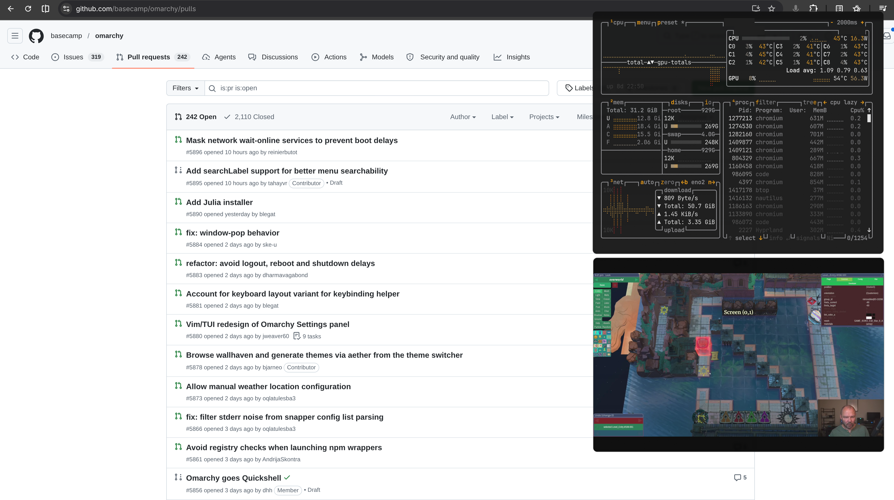
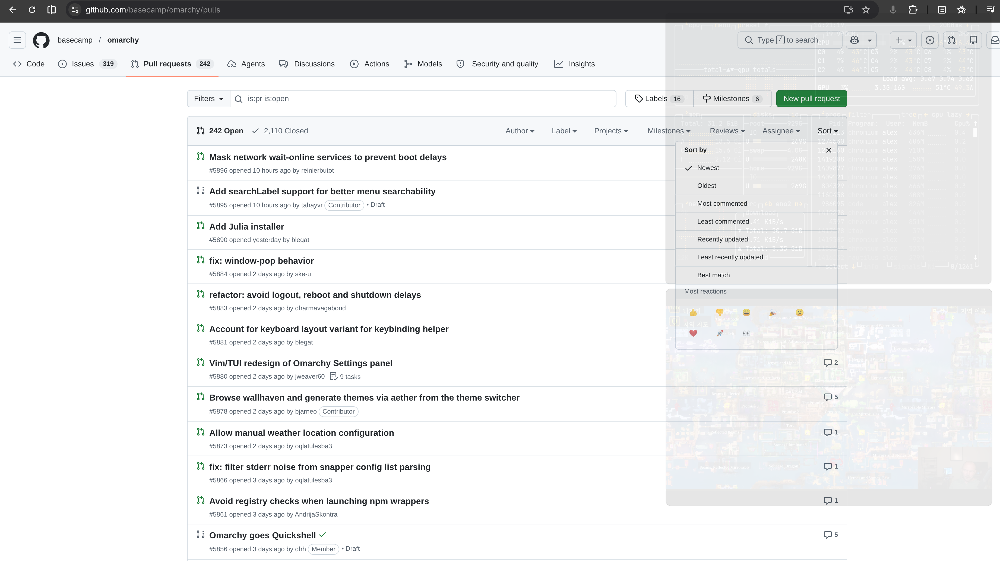

# Peek

Fades floating Hyprland windows to minimal opacity and disables them so you can
see and interact with the content underneath.

Opening a new window exits Peek automatically, so file pickers and other new
dialogs remain visible and usable. Toggle Peek again when you want to resume.





## Install

```bash
omarchy plugin add https://github.com/brianblakely/peek.git --enable --yes
```

## Shortcuts

```lua
o.bind("SUPER + GRAVE", "Toggle floating window peek", "omarchy-shell b.peek toggle")
o.bind("SUPER + ALT + GRAVE", "Enable floating window peek", "omarchy-shell b.peek enable")
o.bind("SUPER + CTRL + GRAVE", "Disable floating window peek", "omarchy-shell b.peek disable")
```

## Update

```bash
omarchy plugin update b.peek
```

## Uninstall

```bash
omarchy plugin remove b.peek
```
